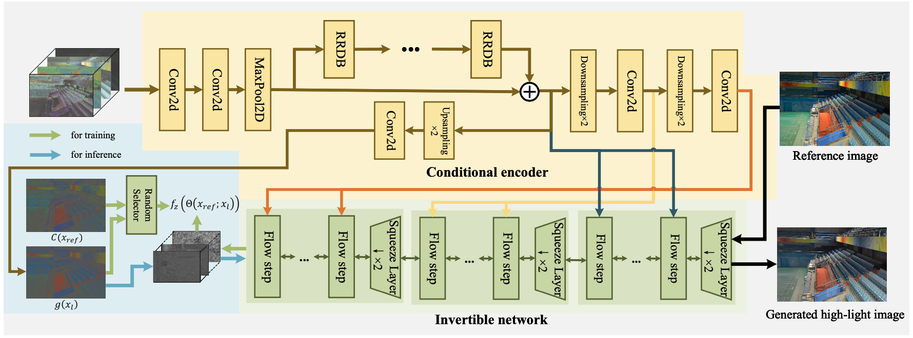

# LLFlow (Fine-Tuned and Optimized Fork)

Low-light image enhancement with normalizing flow, adapted from the original LLFlow work and updated for this project’s fine-tuning and runtime optimization workflow.

### [Original Paper](https://arxiv.org/pdf/2109.05923.pdf) | [Original Project](https://wyf0912.github.io/LLFlow/)

The training and inference pipeline has been adapted for:
* Fine-tuning on custom paired low/high datasets
* Stability-focused inference behavior
* Preprocessing options such as log-space low-light input and histogram-equalization concatenation
* Practical paired and unpaired test scripts with result export


### Framework


### Visual Example


### Environment Setup
* Python 3.8
* CUDA-enabled PyTorch
* GPU for training and inference

```bash
git clone git@github.com:StrikerEurika/LLFlow.git
cd LLFlow/code
pip install -r requirements.txt
```
```bash
# Install PyTorch for your CUDA version
pip install torch torchvision --index-url https://download.pytorch.org/whl/cu118

# For Conda
conda create -n llflow python=3.8 -y
conda activate llflow
cd LLFlow/code
pip install -r requirements.txt
```

## Dataset Layout
### LOL
Set dataset root to the folder that contains:
```plain
<LOL_ROOT>/
  our485/
    low/
    high/
  eval15/
    low/
    high/
```
This is required by `Lol_dataset.py`
### LOL-v2
Set dataset root to the folder that contains:
```plain
<LOLV2_ROOT>/
  Synthetic/
    Train/
      Low/
      Normal/
    Test/
      low/
      high/
  Real_captured/
    Train/
      Low/
      Normal/
    Test/
      low/
      high/
```
This is required by `Lol_dataset.py`

### Custom Paired Dataset
Set dataset root to:
```plain
<CUSTOM_ROOT>/
  low/
  high/
```
Used by dataset type Custom in `Custom_smallNet_custom.yml`

### Training
```bash
cd code
python train.py --opt confs/LOL_smallNet.yml --tfboard

# Other examples
python train.py --opt confs/LOL-pc.yml --tfboard
python train.py --opt confs/LOLv2-pc.yml --tfboard
python train.py --opt confs/Custom_smallNet_custom.yml --tfboard
```
Outputs are created under:
```plain
LLFlow/experiments/<experiment_name>/
```
Including checkpoints, logs, validation images, and TensorBoard logs.

### Paired Evaluation (PSNR / SSIM / LPIPS)
Run:
```bash
python test.py --opt confs/LOL_smallNet.yml
```
This script:
* Loads dataroot_LR and dataroot_GT from config
* Runs enhancement
* Saves enhanced images under:
* Saves metrics CSV with timestamp under:
* Implementation: `test.py`


### Unpaired Evaluation / Inference Batch
Run:
```bash
python test_unpaired.py --opt confs/LOL_smallNet.yml -n unpaired_results
```

This script:
* Loads images from dataroot_unpaired
* Saves outputs to:
* Implementation: `test_unpaired.py`

## Using In Your Own Project
Use `using.py` for folder-level enhancement.

Command:
```bash
python using.py \
  --input /path/to/input_folder \
  --output /path/to/output_folder \
  --model_path /path/to/latest_G.pth \
  --conf confs/Custom_smallNet_custom.yml
```

Arguments:
* --input: folder containing low-light images
* --output: folder to save enhanced images
* --model_path: path to trained weights
* --conf: model architecture/config yaml
* Implementation: `using.py`

## License and Attribution

This project is based on LLFlow and includes third-party licensed components.
See:
* LICENSE
* README.md
If you use this work academically, please cite the original LLFlow paper:
```plain
@article{wang2021low,
  title={Low-Light Image Enhancement with Normalizing Flow},
  author={Wang, Yufei and Wan, Renjie and Yang, Wenhan and Li, Haoliang and Chau, Lap-Pui and Kot, Alex C},
  journal={arXiv preprint arXiv:2109.05923},
  year={2021}
}
```


